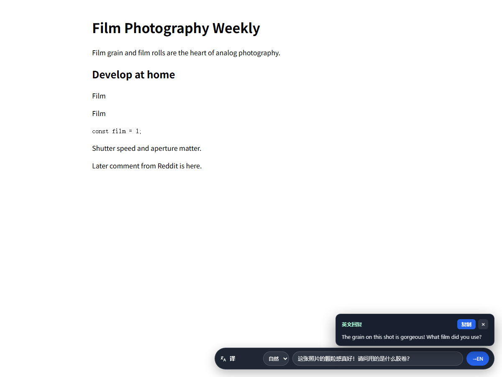
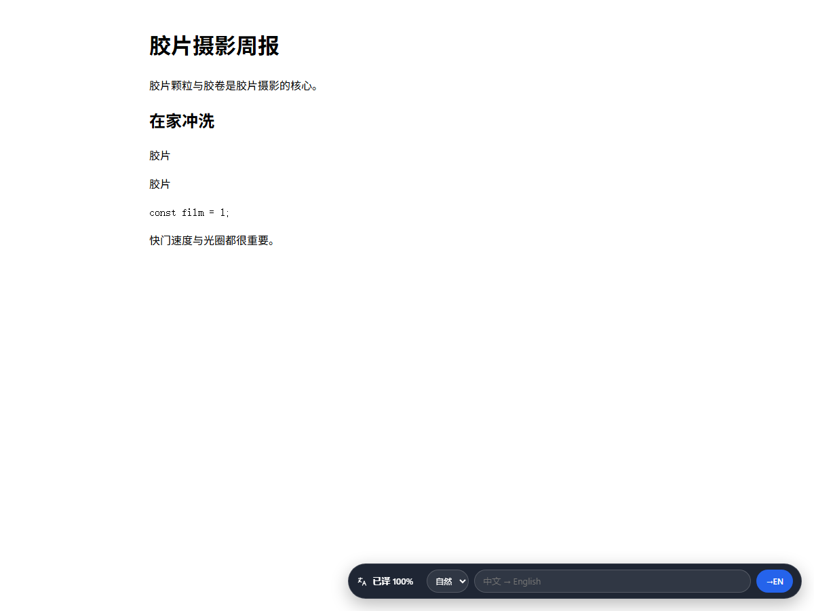

# dsh-page-translator · 整页翻译（DSH 插件 + Edge 扩展）

同一套「结合整页主题、原地替换、保留版式」的翻译，现在有两个入口：

- **DSH 内置侧边栏浏览器**（Electron `<webview>`）：右侧浏览器打开页面，右下角「译」；
- **Edge 浏览器扩展**（MV3，可加载到 Edge/Chrome）：任何网页右下角「译」，翻译仍走本机 DSH 的模型。

- **翻译是结合整页主题的**，不是逐句机翻：胶片摄影社区里 `Film → 胶片/胶卷`、
  `Develop → 冲洗`、`Magazine（16mm）→ 装片暗盒`。
- **回复输入框（中文 → 英文）**：「译」按钮右侧有一个输入框，输入中文回复，按回车或点 `→EN`，
  会结合当前页面/社区的主题与语气给出地道英文回复，顶部浮层显示并可一键复制——专门给
  Reddit 这类英文社区的评论互动用。
- **语气选择**：输入框左边是语气下拉框（自然 / 口语 / 幽默 / 专业），同一句中文可以按不同语气重译。
- **网感处理**：提示词里内置中文网络流行语/圈内梗的意译规则（报恩/报仇、真香、入坑、刀锐奶化、
  一镜走天下等），并要求像母语者发评论一样短、口语、有态度，而不是逐字直译。
- **进度与自动跟随**：控件只显示「翻译中 42% / 已译 100%」这样的百分比，不再显示段数与梗概；
  翻译完成后，Reddit 的翻页、无限滚动、展开评论等新出现的内容会**自动继续翻译**，不用手动还原再点。
- **「译」控件可拖动**：按住胶囊本体（图标/文字区域）拖到任意位置，点按仍是原来的翻译/还原；
  位置会被记住（见下），窗口变小时自动收回视口内，回复浮层也会跟着控件换位。
- **不经过代理**：直接操作真实页面，页面脚本、登录态、交互、版式全部保留。
- **调用 DSH 宿主模型**（`ctx.llm`，推理强度 off），插件与扩展都不持有 API key。

## 使用

1. 右侧内置浏览器打开任意网页（或在 Edge 里打开任意网页，见下节）。
2. 页面右下角出现按钮（图标与原先侧栏「网页翻译」图标一致）：点它开始翻译。
   **按住胶囊空白处拖动**（图标或文字区域；输入框、语气下拉、`→EN` 按钮上按下不会拖动），
   位置会记住：内置浏览器里跨页面生效；Edge 扩展也跨页面生效；代理模式只在当前页面内有效。
3. 整页原地翻译；按钮显示实时百分比「翻译中 42%」，完成后是「已译 100%」；再点一次还原原文。
   翻译状态下继续滚动/翻页 Reddit，新内容会自动译好（短暂显示「更新中 …%」）。
4. 想在社区里回复：在「译」右侧输入框写中文（输入框会自动增高，最多 4 行），选好语气（默认「自然」），
   回车或点 `→EN`，上方浮层会给出英文回复，点「复制」再粘到 Reddit 的评论框里。
   浮层现在贴着「译」控件显示（上方放不下时翻到下方），不再固定右下角。



### 网感示例（真实模型输出）

| 中文草稿 | 改之前（直译） | 现在（默认自然语气） |
| --- | --- | --- |
| 这是一枚报恩的镜头，不要修理他！ | this is a lens that's repaying you for your kindness. Don't fix it! | Absolutely great photos — this lens has been good to you, don't you dare get it repaired! |
| 这镜头真香，出片绝了，刀锐奶化，我已经彻底入坑了。 | This lens is really fragrant, the shots are amazing, knife-sharp and creamy, I've completely fallen into the pit. | This lens is actually amazing—I was wrong to doubt it. The shots it produces are unreal, razor-sharp with creamy bokeh. I'm completely hooked now. |
| 太棒了，谢谢分享！我也想试试在家自己冲洗胶片。 | — | Awesome, thanks for sharing! I want to try developing film at home myself too. |

同一句「报恩的镜头」在「口语」语气下会变成 `…don't ever fix it!`，在「幽默」语气下会变成
`…don't you dare fix it!`——下拉框切换后会重新生成。

内置浏览器模式和 Edge 扩展共用同一个页面控制器，所以两边都有输入框和语气选择；回复会
读取当前页面的主题/领域/术语表，语气贴合社区。

Web 版 DSH 的内置浏览器是跨域 iframe，插件读不到它的 DOM；内置浏览器模式只在
Desktop 版生效（这正是 exe 安装版的场景）。

## Edge 浏览器扩展

扩展位于 [`edge-extension/`](edge-extension/)，是一个**未打包的 MV3 扩展**（Edge / Chrome 通用）。
它自己不做模型调用：内容脚本把页面文本经 service worker 发到本机 DSH 的扩展桥
（`http://127.0.0.1:34118/ext/*`），由 DSH 用当前默认模型结合整页主题翻译。

### 安装（Edge）

1. 确认 DSH 桌面版正在运行（扩展依赖它的宿主桥）。插件配置里已固定桥端口 `34118`。
2. Edge 地址栏打开 `edge://extensions` → 打开「开发人员模式」。
3. 点「加载解压缩的扩展」→ 选择本插件的 `edge-extension` 目录
   （`...\plugins\dsh-page-translator\edge-extension`）。
4. （可选）点扩展的「扩展选项」：桥地址默认 `http://127.0.0.1:34118`，可改端口/目标语言；
   点「测试连接」应显示 `连接成功：DSH 扩展桥 v0.3.0`。
5. 打开任意 http/https 网页 → 右下角「译」→ 点击翻译；再点还原。
   输入框里写中文 → 回车/`→EN` → 得到英文回复（`复制` 后贴到 Reddit 等社区）。



### 注意

- **DSH 必须保持运行**（翻译使用 DSH 的模型额度与凭据）；DSH 关闭时点按钮会显示连接失败。
- 桥只监听 `127.0.0.1:34118`，不暴露到网络；普通网页因 CORS 读不到响应，
  只有扩展的 service worker（声明了 host 权限）能调用。
- 若 34118 被占用，插件会回退到随机端口（DSH 内置浏览器不受影响，但扩展会连不上）；
  此时改桥端口或在插件配置里指定其它空闲端口。
- `edge://`、`chrome://`、扩展商店等浏览器内部页面无法注入；PDF 阅读器内也不保证可用。
- 控件的关键尺寸（34px 高、min/max-height、margin、padding、line-height、字体）用
  **inline `!important` 锁定**，所以 Reddit 这类站点对 `textarea/select/button` 的
  `!important` 全局样式不会把控件撑歪；E2E 里专门注入敌对 CSS 验证过对齐。
- 想在插件侧加一道访问令牌：配置 `extensionToken: <随机串>`，并在扩展选项的「扩展访问令牌」里填同一个值。

## 实现

```
右侧内置浏览器（Electron <webview>，位于 DSH 渲染进程的 DOM 中）
  │  client.js 扫描 webview[data-sidebar-browser-frame="webview"]
  │  executeJavaScript → 注入 lib/page-script-hosted.js（「译」按钮 + 回复输入框 + DOM 控制器）
  ▼
真实网页（不被改写、不被代理）
  │  点「译」→ 页面把请求标记给插件；插件读取 segment + 页面主题
  │  输入框提交 → 页面把中文草稿交给插件 → 译成英文回到浮层
  ▼
宿主（index.js → lib/service.js，注册在 DSH web server 上）
  ├─ GET  /page-translator/hosted.js   页面控制器源码
  ├─ POST /page-translator/context     每页一次：主题 + 术语表（ctx.llm）
  ├─ POST /page-translator/translate   分块并行翻译（逐块回填）
  ├─ POST /page-translator/compose     中文草稿 → 英文回复（结合页面语气）
  ├─ POST /page-translator/log         诊断日志 → ~/.dsh/page-translator.log
  └─ ctx.llm.resolveCallConfig → prepareCall → stream（reasoning off）
```

译文/上下文缓存在宿主进程内（LRU），同页第二次几乎瞬时。

### 悬浮控件拖动与位置记忆

- **拖动判定**：`pointerdown → pointermove` 超过 **5px** 才算拖动（`setPointerCapture` 捕获指针，
  `pointerup` / `pointercancel` 结束）；拖动结束会吞掉随之而来的那次 `click`，所以不会误触发
  整页翻译/还原；没超过阈值仍是普通点击。
- **拖动对象**：整条「译」胶囊都可拖，但按在 `input/textarea/select/button/a/label` 等交互控件上
  不会开始拖动（输入框、语气下拉、`→EN` 按钮保持原生行为）。
- **定位方式**：首次拖动后把 `right/bottom` 换成 `left/top`，并用 `clamp` 限制在视口内（**8px** 边距）；
  `window resize` 时重新 clamp。回复浮层按「优先贴控件上方、放不下则翻到下方」重新锚定。
- **位置记忆范围**：
  - DSH 内置浏览器：跨页面。页面脚本通过已有的 `executeJavaScript` 轮询桥新增的
    `pollPillPosition()` 把 `{x,y}` 交回渲染进程，由 `client.js` 存进 **DSH 渲染进程自己的
    localStorage**（键 `dsh.page-translator.pill-position.v1`）；下次注入前用
    `window.__DSH_PT_PILL_POS__` 交回页面（或对已存在的控制器调用 `setPillPosition()`）。
  - Edge/Chrome 扩展：跨页面。内容脚本把坐标存进**扩展的** `chrome.storage.local`
    （键 `dshPtPillPosition`），注入后恢复。
  - 代理模式（`/p?url=`，`lib/page-script.js`）：仅当前页面内有效（模块内存变量），没有宿主桥。
- **安全边界**：不写被访问站点的 cookie / localStorage，不新增任何网络请求（拖动只走已有的
  注入桥与扩展 storage）。

Edge 扩展的路径相同，只是「点击 → 读取 DOM」由内容脚本完成，网络经 service worker：

```
Edge 页面（内容脚本：page-script-hosted.js + content.js）
  │ 点「译」→ 收集 segment + 页面主题
  │ 输入框提交 → chrome.runtime.sendMessage → service worker（声明 host_permissions，绕过 CORS）
  ▼
本机 DSH 扩展桥 http://127.0.0.1:34118/ext/context、/ext/translate、/ext/compose、/ext/health
  └─ 复用同一套 LlmTranslator（ctx.llm，reasoning off）与同一份缓存
```

## 安装

方式一（GitHub，推荐）：

```bash
dsh plugin --profile <profile> add github:SenhoiBot/dsh-page-translator
```

也可以在本机克隆后以本地目录安装（`link:` 依赖 + `dsh.profile.bundles`）：

```bash
dsh plugin --profile <profile> add "link:<本插件绝对路径>"
```

装好后刷新页面，右侧内置浏览器打开任意网页，右下角会出现「译」按钮。

> 改 Host 代码（`index.js`、`lib/*.js`）后需让插件重新加载（重启该 DSH 实例）；
> 改 `client.js`/`page-script-hosted.js` 后刷新页面并重载内置浏览器页面即可
> （hosted 脚本每次请求都从磁盘读取）。

## 配置

在 profile patch 里按插件行 id 覆盖（全部可省略）：

```yaml
- id: dsh-page-translator
  config:
    provider: deepseek-account   # 默认按 DSH 默认模型
    model: deepseek-flash
    target: zh                   # zh/en/ja/ko/ru
    port: 34118                  # Edge 扩展桥的固定回环端口（0 = 随机）
    extensionToken: ''           # 可选：扩展访问令牌（与扩展选项里填同一个值）
    callTimeoutMs: 25000
    llmConcurrency: 8
```

> 桌面 profile 已配置 `port: 34118` 供扩展使用；若端口被占用，插件会回退到随机端口
> （内置浏览器仍可用，扩展会提示连不上）。

## 验收证据

| 检查 | 结果 |
| --- | --- |
| 单元/集成测试 `node --test` | **51 个全过**（含 webview 挂载、hosted 控制器与回复输入框/语气/进度/`follow()`、**拖动不触发 toggle / 视口 clamp / resize 重新 clamp / 浮层翻转锚定 / 位置上报与恢复**、宿主路由、扩展桥 /ext 路由、扩展内容脚本 + 后台 + 桥的集成、SPA 新内容自动跟随） |
| 真实宿主 LLM（`e2e/builtin-live.mjs` / `e2e/speed.mjs`） | hosted.js 200；context 冷 2.9s / 缓存 10ms；分块 0.85–1.0s；`Film→胶片`、`Develop your own roll→在家冲洗你自己的胶卷`；`reasoningEffort:"off"` |
| 回复输入框（`e2e/compose-live.mjs`，真实模型） | 「报恩的镜头」不再直译：`…this lens has been good to you, don't you dare get it repaired!`（自然）、`…don't ever fix it!`（口语）、`…don't you dare fix it!`（幽默）；「真香/出片绝了/刀锐奶化/入坑」→ `I was wrong to doubt it / unreal / razor-sharp with creamy bokeh / completely hooked` |
| 真实 Edge + 扩展（`e2e/edge-extension.mjs`） | 加载未打包扩展 → 整页翻译（控件显示「已译 100%」）→ **追加新内容后自动翻译（follow PASS）** → 还原（含新内容）→ 输入中文 → 英文回复；测试页注入 `textarea/select/button { min-height:64px!important; ... }` 的敌对 CSS，四个控件实测高度均为 **34px**、中心线一致（**alignment PASS**）；截图 `docs/edge-extension.png`、`docs/edge-extension-compose.png` |
| 真实宿主（desktop profile） | 内置浏览器模式已由用户确认可用 |

复跑：

```bash
node --test
node e2e/builtin-live.mjs --host http://127.0.0.1:<hostPort> --url https://filmphotographyproject.com/
node e2e/compose-live.mjs --host http://127.0.0.1:<hostPort> --url https://filmphotographyproject.com/
node e2e/compose-live.mjs --host http://127.0.0.1:<hostPort> --text "这镜头真香，出片绝了，刀锐奶化" --tone casual
node e2e/edge-extension.mjs --bridge-url http://127.0.0.1:34118   # 需 DSH 运行
```

## 性能（v0.6.0）

推理强度**已经是 `off`**（日志里 `reasoningEffort:"off"` 可证），慢不来自思考；慢在两次往返：

1. **页面主题分析**：每页一次小调用（输入页面标题/标题/正文片段，输出主题+术语表），
   冷启动约 2.9s——但它现在会在**页面打开后于后台预取**，点击时通常已命中缓存（~10ms）。
2. **分块翻译**：每块的模型首 token + 生成约 0.8–1s。v0.2.1 把块从 1400 字符/26 段
   缩到 **700 字符/14 段**，并发 4→**8**，把一个大块串行等待改成多块并行。

实测（真实模型 `deepseek-flash`，`e2e/speed.mjs`）：

| 场景 | 耗时 |
| --- | --- |
| 页面主题分析（冷，后台预取） | ~2.9s（点击时不等它） |
| 主题分析（缓存命中） | ~10ms |
| 典型页面翻译（26 段，2 块并行） | **~1.0s** |
| 大页面翻译（90 段，6 块并行） | **~1.6s** |
| 同一页二次翻译（全缓存） | **~10ms** |

如果还嫌慢，下一步可做「页面打开后后台预翻译首屏」，点击几乎瞬时（会多花 token，默认不做）。

## 诊断

如果某个页面没有出现按钮，或点击没反应，看 `~/.dsh/page-translator.log`：

- `bridge-installed` / `webviews`：客户端是否运行、发现了几个内置浏览器页面
- `inject` / `inject-unexpected`：脚本是否注入成功
- `prefetch`：页面主题是否已后台预取（含耗时与 `llm.reasoningEffort`）
- `action` / `translated` / `translate-error`：点击、总耗时、`contextMs`、`chunkMs` 明细
- `dom-ready`：内置浏览器页面刷新/导航

## 已知限制

- 只翻译**可见文本节点**：图片内文字、`canvas`、`input/textarea` 的值、跨域 iframe 不翻。
- 只作用于内置浏览器的 `<webview>`（Desktop）；Web 版的跨域 iframe 无法读取。
- 回复输入框是**中文/任意语言 → 英文**的单向翻译，一次最多 4000 字符；结果是可复制的文本，
  **不会自动填进页面的评论框**（不同社区输入框差异太大），复制后自行粘贴。
- 自动跟随用 `MutationObserver` + 轮询：Reddit 这类 SPA 的翻页/无限滚动/展开评论会在
  ~0.3–1s 内补译；虚拟列表把整块 DOM 换掉时同样会补译，但极高频滚动的瞬间可能看到短暂原文。
- 页面本身已是中文时跳过（默认 `target: zh`）。
- 「译」控件位置：内置浏览器存在 DSH 渲染进程的 localStorage（清站点数据/换 DSH 实例会重置），
  Edge 扩展存在扩展 storage，代理模式仅当前页面；窗口变窄或旋转时会被 clamp 回视口内（8px 边距）。
  拖动只改控件坐标，不写被访问站点的 cookie/localStorage，也不产生网络请求。
- 页面自身脚本若在翻译后重写 `textContent`，个别节点可能回退；重翻一次即可。
- 译文只缓存在进程内，不落盘、不写会话日志。

## 目录

```
index.js                    宿主入口（bundle row）
client.js                   客户端半：发现 webview、注入控制器、转发翻译/回复、跟随 SPA 新内容、记住「译」控件位置
edge-extension/             Edge/Chrome MV3 扩展（manifest / 内容脚本 / service worker / 设置页）
lib/service.js              生命周期 + /page-translator/* 路由 + 状态文件
lib/browser-bridge.js       宿主路由（hosted.js / context / translate / compose / log）
lib/page-script-hosted.js   页面内控制器（进度、回复输入框、可拖动控件 + 位置上报、DOM 遍历/回填/还原、follow 观察器）
lib/llm.js                  宿主 LLM 桥（route、reasoning off、JSON 解析、重试、回复翻译）
lib/prompts.js              提示词（页面主题/术语表 + 分块翻译 + 社区回复）
lib/server.js               回环 HTTP：/p 代理改写、/pt.js、/api/*、/ext/*（扩展桥，含 compose）
lib/html-rewrite.js         目标页改写（保留布局、注入 base/boot/script）
lib/page-script.js          代理模式页面内脚本（可拖动控件，仅本页记忆）
test/                       单元 / 集成测试
e2e/                        真实宿主 / 真实浏览器 / Edge 扩展验证脚本
docs/                       验收截图
```

## License

MIT
